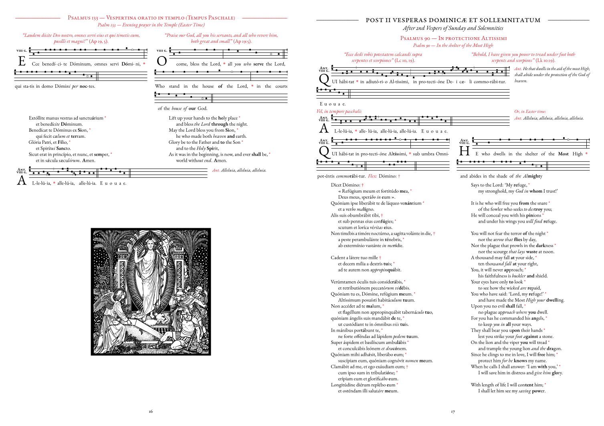

# Latin-English Compline Chant-Booklet

This is an A4 booklet for Compline (Latin: *Ad Completorium*) according to the 1971 Liturgy of the Hours (Latin: *Liturgia Horarum*). It has Latin and English side-by-side. See the [Releases](https://codeberg.org/JeremyCains/BilingualCompline/releases) page for the PDFs themselves.



Compline, also called Night Prayer, is the final Hour of the Liturgy of the Hours, which is sung before retiring at night.

This booklet contains all the texts for singing Compline for every day of the year. The Introductory verse, hymn, *Nunc Dimittis* and antiphons have musical settings only in Latin. The rest (the Psalms, readings and other prayers) have musical settings in Latin and English.

There are two PDFs (both found in [Releases](https://codeberg.org/JeremyCains/BilingualCompline/releases)): one A4, and the other A3. The A4 is simply sequential. The A3 has two A4 pages per A3 page, and can be folded into a book.

The texts are from the current Latin and English books, as of 2026. The English translations of the hymns are from [Universalis](https://universalis.com/index.htm).

The Gregorian chant is taken principally from Joerg Hudelmaier's compilation of chants for the 2015 Ordo Cantus Officii (OCO), which can be found at [www.antiphonale.net/](https://www.antiphonale.net/), or in [PDF](https://www.antiphonale.net/oco.pdf). Other pieces where compiled from his [Easter chants PDF](https://antiphonale.net/OCO/DeTempore/Paschali/Libellus.pdf), from Steven van Roode's [*Ad Completorium*](https://www.kleingraduale.nl/LiturgiaHorarum/), and from the 2009 *Antiphonale Romanum II* and 2005 *Antiphonale Monasticum* from the monks of Solesmes. I must also thank Benjamin Bloomfield for his chant tools, and the people behind the Gregorio project. God bless these men.

While the final PDF is quite clean, the files used to make it could be more elegant:

- There are a lot of `\vspace` commands to ensure things stay on the right page
- The GABC files use `!` before every quilisma to remove the gap.
- The hymns take the full line because of a hand-coded space (e.g. `(::\[10])`).
- Not all GABC files have all the headers filled-in.
- Some of the indenting in the translations is hand-done by `\hspace*` commands.
- The file structure/naming is not very nice.

I am hoping that by sharing both the final PDFs and the working files, people will be able to sing to God and that He may be glorified by their voices, and that others might use the files for a similar purpose, such as replacing the English with other languages, as they see fit.

## Compiling

This project uses [GregorioTex](https://gregorio-project.github.io/gregoriotex/index.html). Instructions for installation can be found here: [GregorioTex installation instructions](https://gregorio-project.github.io/installation.html) (this assumes a TEX distribution with Lualatex, as the page explains).

Then, having cloned this repository, in the command line, navigate to the directory containing this `README.md` file, then run the following commands:

```sh
cd FullBook
lualatex Compline.tex
```

You may need to re-run the last command for the links to other pages to work.
